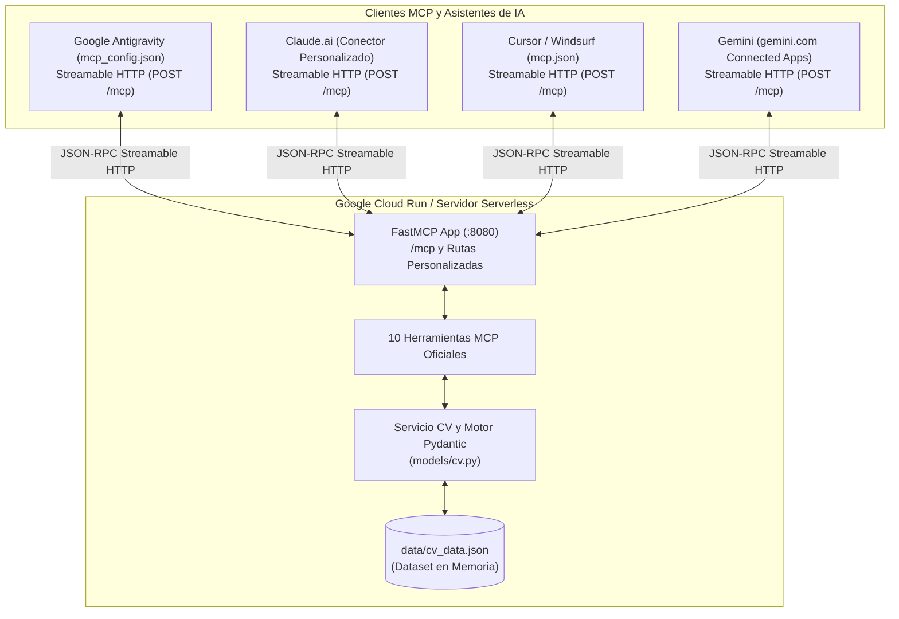
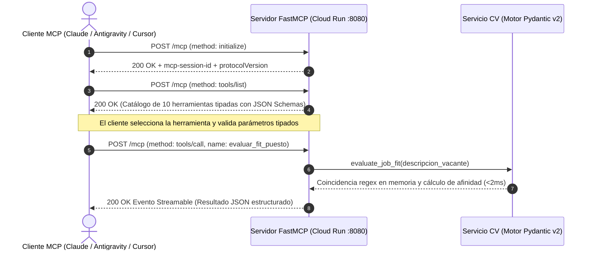

<p align="center">
  
</p>

# Servidor MCP de Ana-Catalina

[English](README.md) | [Español](README.es.md)

<p align="center">
  <a href="https://www.python.org/"></a>
  <a href="https://docs.pydantic.dev/"></a>
  <a href="https://modelcontextprotocol.io/"></a>
  <a href="https://cloud.google.com/run"></a>
  <a href="https://www.docker.com/"></a>
  <a href="https://docs.pytest.org/"></a>
  <a href="LICENSE"></a>
</p>

> **Servidor Oficial de Model Context Protocol (MCP)** con transporte **Streamable HTTP** sobre FastMCP, exponiendo un CV y portafolio interactivo para asistentes de IA (Google Antigravity, Claude.ai, Cursor, Windsurf, Gemini) y clientes LLM. Incluye showcase web interactivo y contenedor listo para producción en Google Cloud Run.

<div align="center">
  <h3>URL del Servidor en Vivo:</h3>
  <p><strong><a href="https://mcp.ana-catalina.com/">https://mcp.ana-catalina.com/</a></strong></p>
  <small>(Espejo en Cloud Run: <code>https://anacatalina-mcp-165536131179.us-central1.run.app/</code>)</small>
</div>

---

## Descripción del Proyecto

Este proyecto implementa un servidor oficial de **Model Context Protocol (MCP)** en Python que permite a evaluadores técnicos, reclutadores y modelos LLM (como Claude o GPT) explorar de forma interactiva y estructurada la trayectoria profesional, habilidades técnicas, proyectos insignia y compatibilidad con vacantes de **Ana-Catalina Villalobos Contardo** (Data Scientist & Machine Learning Engineer).

### Dos Interfaces, Diseñadas para Dos Audiencias

| Audiencia | Punto de Entrada | Propósito y Experiencia |
| :--- | :--- | :--- |
| 🤖 **Agentes de IA e Ingenieros de Protocolo** | Streamable HTTP (`POST /mcp`) | Integración directa máquina a máquina para Google Antigravity, Claude.ai, Cursor, Windsurf y Gemini mediante JSON-RPC 2.0 con esquemas fuertemente tipados en Pydantic v2. |
| 👤 **Reclutadores y Evaluadores Técnicos** | Showcase Web Interactivo (`GET /` o `/demo`) | Playground interactivo en navegador bajo el *Pastel-Tech Design System* sin necesidad de instalación, con benchmarks deterministas de afinidad técnica y respuestas instantáneas sub-5ms. |

### Características Principales
- **Web Showcase & Playground Interactivo:** Servido directamente en `/` (responde 200 OK directamente a navegadores mediante negociación transparente de contenido, con `/demo` como alias directo) bajo el *Pastel-Tech Design System*. Permite a reclutadores y visitantes humanos evaluar compatibilidad con vacantes y buscar en el currículum en tiempo real con latencia inferior a 5ms y resultados 100% verificables en memoria.
- **Negociación Transparente de Contenido:** Devuelve la aplicación web interactiva directamente a navegadores (`Accept: text/html`) con HTTP 200 sin redirecciones, preservando el JSON de descubrimiento original para agentes y cURL.
- **Transporte Moderno Streamable HTTP (`/mcp`):** Transporte nativo recomendado por la especificación MCP para conexiones directas desde **Google Antigravity** (`mcp_config.json`), **Claude.ai** (conectores personalizados), **Gemini** (gemini.com Connected Apps) y **Cursor / Windsurf** (`mcp.json`).
- **10 Herramientas MCP Especializadas:** Consulta granular de experiencia laboral, stack tecnológico con niveles de dominio, proyectos insignia, evaluación automática de vacantes, búsqueda global por palabras clave, educación, contacto y perfil general.
- **Desacoplamiento y Rendimiento:** Datos estructurados en `data/cv_data.json` validados en memoria con **Pydantic v2** al iniciar el contenedor (<2ms por consulta).

---

## Arquitectura



### Ciclo de Vida del Protocolo y Demostración en Vivo



#### Ejemplo Real de Invocación del Protocolo

1. **Solicitud (`POST https://mcp.ana-catalina.com/mcp`):**
```json
{
  "jsonrpc": "2.0",
  "id": 1,
  "method": "tools/call",
  "params": {
    "name": "evaluar_fit_puesto",
    "arguments": {
      "descripcion_vacante": "Senior Machine Learning Engineer con Python, GCP, BigQuery y Docker"
    }
  }
}
```

2. **Respuesta Estructurada (`200 OK`, `text/event-stream`):**
```json
{
  "jsonrpc": "2.0",
  "id": 1,
  "result": {
    "structuredContent": {
      "target_role_detected": "Senior Data Scientist / Machine Learning Engineer",
      "estimated_fit_score": "85% (Alta Compatibilidad)",
      "technologies_matched": ["Python", "BigQuery", "Google Cloud Platform (GCP)", "Docker"],
      "matching_strengths": [
        "Experiencia en producción en SimpliRoute aplicando Python, BigQuery y GCP en optimización logística y servidores MCP.",
        "Trayectoria en Fracttal liderando pipelines analíticos, mantenimiento predictivo y despliegues con Python.",
        "Dominio profundo del ecosistema de datos y machine learning en Google Cloud."
      ],
      "added_value_summary": "El perfil de Ana-Catalina ofrece alta sinergia en Python, BigQuery, Google Cloud Platform (GCP), Docker, combinando experiencia real en producción en startups tecnológicas de alto crecimiento con sólida formación en ingeniería civil, analítica avanzada y modelamiento predictivo."
    },
    "isError": false
  }
}
```

---

## Catálogo de Herramientas MCP

El servidor expone **10 herramientas oficiales** registradas a través del protocolo MCP:

| Herramienta | Parámetros | Tipo de Retorno | Descripción |
| :--- | :--- | :--- | :--- |
| `obtener_experiencia` | `empresa` *(str, opcional)* | `List[ExperienceItem]` | Historial laboral detallado, roles, responsabilidades y tecnologías empleadas. Permite filtrar por empresa. |
| `obtener_stack_tecnologico` | `categoria` *(str, opcional)*<br/>`nivel` *(str, opcional)* | `List[SkillCategory]` | Tecnologías, lenguajes (Python, SQL), Cloud/GCP (BigQuery, Vertex AI) y Docker organizados por categoría y nivel (Avanzado, Intermedio). |
| `obtener_proyectos_destacados` | `tipo` *(str, opcional)*<br/>`tecnologia` *(str, opcional)* | `List[ProjectItem]` | Proyectos insignia (laborales y personales), arquitectura, stack tecnológico y enlaces a repositorios/demos. |
| `evaluar_fit_puesto` | `descripcion_vacante` *(str, requerido)* | `FitEvaluationResult` | Analiza los requerimientos de una vacante laboral y calcula el porcentaje de compatibilidad, fortalezas coincidentes y propuesta de valor. |
| `buscar_en_curriculum` | `consulta` *(str, requerido)* | `SearchResult` | Búsqueda transversal por palabra clave en todo el currículum (experiencia, habilidades, proyectos y educación), validada con modelo Pydantic e indexación retrocompatible por corchetes. |
| `obtener_educacion` | *Ninguno* | `List[EducationItem]` | Formación académica formal, grado obtenido, institución y especialización. |
| `obtener_publicaciones` | *Ninguno* | `List[PublicationItem]` | Publicaciones científicas indexadas (Structural Health Monitoring, Procesos Gaussianos e inferencia Bayesiana). |
| `obtener_contacto` | *Ninguno* | `ContactDetails` | Canales directos de contacto profesional (Email y perfil de LinkedIn). |
| `obtener_perfil` | *Ninguno* | `PersonalInfo` | Perfil general: nombre, cargo actual, ubicación y enlaces de portafolio (incluyendo GitHub). |
| `obtener_resumen_ejecutivo` | `idioma` *(str, default="es")* | `str` | Síntesis ejecutiva del perfil profesional enfocada en Data Science, ML, GCP y arquitecturas MCP en español (`es`) o inglés (`en`). |

---

### Stack Tecnológico

- **Lenguaje y Runtime:** Python 3.12+
- **Framework MCP y Transporte:** SDK Oficial de Anthropic (`mcp>=1.3.0,<2.0.0`, `FastMCP` sobre Streamable HTTP `/mcp`)
- **Servidor Web / ASGI:** Starlette (`<2.0.0`) + Uvicorn (`<1.0.0`) + Middleware ASGI Puro de Seguridad y Rate Limiting
- **Validación de Datos y Contratos:** Pydantic v2 (`<3.0.0`)
- **Showcase Frontend:** HTML5, CSS3 (*Pastel-Tech Design System*) y ES6 autocontenido (`/demo` y `GET /`)
- **Contenedorización y Cloud:** Docker sin privilegios (`python:3.12-slim`, `appuser`) desplegado en Google Cloud Run
- **Pruebas y Auditoría de Seguridad:** `pytest`, `pytest-asyncio`, `pytest-cov`, `pip-audit` y GitHub Actions (`test.yml`, `upstream-drift.yml`, Dependabot)

---

## Instalación y Uso Local

### 1. Clonar el Repositorio y Configurar Entorno

```bash
git clone https://github.com/AnaCataVC/anacatalina-mcp.git
cd anacatalina-mcp

# Crear y activar entorno virtual
python -m venv .venv
source .venv/bin/activate  # En Windows PowerShell: .venv\Scripts\Activate.ps1

# Instalar dependencias de producción y desarrollo
pip install -r requirements.txt
pip install -r requirements-dev.txt
```

### 2. Iniciar el Servidor MCP Local

```bash
uvicorn server:app --host 0.0.0.0 --port 8080 --reload
```

### Pruebas Automatizadas y Automatización de Tareas

Ejecutar la suite completa de pruebas automatizadas y las tareas de automatización para desarrolladores mediante el task runner unificado (`scripts/tasks.ps1` / `scripts/tasks.py`):

```bash
# Ejecutar la suite completa de pruebas con cero regresiones
python scripts/tasks.py test           # O en PowerShell: .\scripts\tasks.ps1 test

# Ejecutar la suite con reporte de cobertura de líneas
python scripts/tasks.py cov            # O en PowerShell: .\scripts\tasks.ps1 cov

# Validar invariantes del ecosistema (Zero Flags, privacidad de rutas, identidad, 10 Tools)
python scripts/tasks.py invariants     # O en PowerShell: .\scripts\tasks.ps1 invariants

# Verificar alineación de datos frente a los repositorios hermanos
python scripts/tasks.py audit          # O en PowerShell: .\scripts\tasks.ps1 audit

# Auditar dependencias en busca de vulnerabilidades conocidas (CVEs)
python scripts/tasks.py sec            # O en PowerShell: .\scripts\tasks.ps1 sec

# Ejecutar el pipeline completo de aseguramiento de calidad (todas las verificaciones)
python scripts/tasks.py check-all      # O en PowerShell: .\scripts\tasks.ps1 check-all
```

### Matriz de Aseguramiento de Calidad y Mitigación de Riesgos

| Preocupación Arquitectónica / Riesgo | Implementación y Salvaguarda en Producción | Evidencia Automatizada Concreta |
| :--- | :--- | :--- |
| **Cumplimiento de Protocolo y Descubrimiento** | FastMCP sobre Streamable HTTP (`POST /mcp`) | Pruebas de contrato para `initialize`, `tools/list` y `tools/call` ([`tests/test_server.py`](tests/test_server.py)) |
| **Estabilidad de Esquemas y Seguridad de Tipos** | Modelos estrictos en Pydantic v2 (`models/cv.py`) | Pruebas de serialización tipada y validación de límites |
| **Manejo Estructurado de Errores** | Validación de envelopes con detalle de errores Pydantic | Pruebas de error automatizadas (`isError: true` en argumentos faltantes o herramientas desconocidas) |
| **Negociación de Contenido (Cero Redirecciones)** | Manejador de rutas ASGI transparente (`GET /` sin redirects) | 7 pruebas de negociación de contenido ([`tests/test_content_negotiation.py`](tests/test_content_negotiation.py)) |
| **Protección contra Tráfico Abusivo y DoS** | Rate limiter de ventana deslizante en memoria ASGI puro | Prueba de rate limiting acotado por IP verificando HTTP `429 Too Many Requests` |
| **Inyección de Cabeceras de Seguridad** | Inyecta `X-Content-Type-Options`, `X-Frame-Options` en toda respuesta | Pruebas de inyección de cabeceras de seguridad |
| **Privilegios de Contenedor y Runtime** | Contenedor Docker Debian slim con usuario sin privilegios (`appuser`) | Sandbox serverless no privilegiado en Google Cloud Run |
| **Vulnerabilidad de Dependencias** | Cotas superiores en dependencias y escaneo de CVEs | Ejecución automatizada de `pip-audit` en pipeline de CI/CD ([`test.yml`](.github/workflows/test.yml)) |
| **Deriva de Datos Inter-Portafolio** | Dataset autocontenido + motor de comparación semántica | Auditoría diaria y PR de auto-remediación automática ([`upstream-drift.yml`](.github/workflows/upstream-drift.yml)) |
| **Invariantes del Ecosistema y Zero Flags** | Validador automatizado de Zero Flags, privacidad de rutas e identidad | Compuerta de verificación de invariantes ([`tests/test_invariants.py`](tests/test_invariants.py)) |

---

## Conectar Asistentes de IA

- **Google Antigravity / Gemini CLI (`~/.gemini/config/mcp_config.json`):**
  ```json
  {
    "mcpServers": {
      "anacatalina-cv": {
        "url": "https://mcp.ana-catalina.com/mcp"
      }
    }
  }
  ```
- **Cursor / Windsurf (`~/.cursor/mcp.json`):**
  ```json
  {
    "mcpServers": {
      "anacatalina-cv": {
        "url": "https://mcp.ana-catalina.com/mcp"
      }
    }
  }
  ```
- **Claude.ai:** Ajustes → Conectores → Agregar conector personalizado → URL: `https://mcp.ana-catalina.com/mcp`
- **Gemini (`gemini.google.com`):** Settings & help → Connected Apps → Custom apps for Spark → Add a custom app → URL: `https://mcp.ana-catalina.com/mcp`
- **cURL / Cliente HTTP Directo:**
  ```bash
  curl -X POST https://mcp.ana-catalina.com/mcp \
    -H "Content-Type: application/json" \
    -H "Accept: application/json, text/event-stream" \
    -d '{"jsonrpc":"2.0","id":1,"method":"tools/list","params":{}}'
  ```

---

### Decisiones de Arquitectura y Aprendizajes

1. **Evolución del Transporte MCP (Migración a Streamable HTTP):**
   - Inicialmente, los servidores MCP remotos dependían de combinaciones multi-endpoint basadas en Server-Sent Events (`/sse` y `/messages/`).
   - La especificación moderna de MCP estandarizó **Streamable HTTP** (`/mcp`) mediante un único endpoint unificado sobre HTTP POST que admite respuestas JSON y flujos en tiempo real (`Accept: application/json, text/event-stream`).
   - Esta arquitectura simplifica drásticamente el despliegue serverless, elimina la necesidad de mantener puentes locales (`stdio`) para clientes remotos y garantiza compatibilidad nativa directa con **Claude.ai**, **Cursor** y **Windsurf**.

2. **Desacoplamiento y Contratos Tipados Pydantic v2 (`SearchResult`):**
   - La separación entre la capa de datos (`data/cv_data.json`), los contratos de interfaz (`models/cv.py`) y la lógica de negocio (`services/cv_service.py`) permite actualizar el contenido del currículum sin modificar el servidor MCP ni arriesgar la compatibilidad de tipos.
   - La formalización de `SearchResult` con Pydantic v2 y soporte de indexación por diccionario (`__getitem__`) expone esquemas JSON Schema formales a asistentes de IA sin romper código existente ni aserciones de pruebas.

3. **Negociación Transparente de Contenido HTTP (Cero Redirecciones):**
   - La raíz `GET /` entrega directamente el HTML a navegadores (`Accept: text/html`) con código HTTP 200 mientras preserva el JSON de descubrimiento para agentes y herramientas de línea de comandos, eliminando la latencia de redirecciones 301/302.
   - La implementación de caché con `@functools.lru_cache(maxsize=1)` garantiza una entrega instantánea del template en producción con recarga automática en desarrollo local (`DEBUG=1`).

4. **Factoría Declarativa de Assets Estáticos y Cobertura de Pruebas:**
   - La centralización de todos los activos estáticos en un registro inmutable `STATIC_ASSETS` en `server.py` eliminó más de 60 líneas de código duplicado, preservando estrictamente las URLs raíz canónicas y previniendo vulnerabilidades de *path traversal*.
   - Suite completa de pruebas automatizadas con **100% de éxito / cero regresiones** cubriendo contratos completos del protocolo MCP (descubrimiento de esquemas, validación de argumentos, sobres de error estructurados), endpoints REST, negociación transparente de contenido, cabeceras de seguridad, rate limiting y coherencia semántica de benchmarks.

5. **Acotamiento de Dependencias y Poda de Paquetes No Utilizados (`requirements.txt`):**
   - La versión `2.0.0` del SDK oficial de MCP introdujo cambios incompatibles en `FastMCP`. Todas las dependencias de producción aplican cotas superiores explícitas (`mcp>=1.3.0,<2.0.0`, `starlette<2.0.0`, `pydantic<3.0.0`) y se eliminaron paquetes no utilizados (`fastapi`) para reducir la superficie de ataque del contenedor.

6. **Detección Automatizada de Deriva (Upstream Drift Detection):**
   - Para mantener los datos de `data/cv_data.json` permanentemente consistentes con los repositorios fuente (`anacatalina-cv` y `projects-hub`), se diseñó un flujo automatizado de auditoría en GitHub Actions (`upstream-drift.yml`) basado en comparación semántica de contenido.

7. **Middleware de Seguridad ASGI Puro, Rate Limiting en Memoria y Endurecimiento DevOps:**
   - Se implementó `SecurityAndRateLimitMiddleware` como un middleware ASGI puro (registrado mediante `app.add_middleware`) en lugar de `BaseHTTPMiddleware` de Starlette para evitar el buffering de respuestas en canales `text/event-stream` (`/mcp`) y preservar la introspección de `app.routes`.
   - Aplica rate limiting de ventana deslizante acotado en memoria por IP (`120 req/min`, máximo 4096 IPs), cabeceras de seguridad HTTP estándar (`X-Content-Type-Options: nosniff`, `X-Frame-Options: DENY`) en todas las respuestas incluyendo `429`, ejecución de contenedor sin privilegios (`appuser`) y auditoría automatizada de vulnerabilidades con `pip-audit` en CI.

---

## Licencia

Este proyecto está bajo la Licencia MIT. Consulta el archivo [LICENSE](LICENSE) para más detalles. Desarrollado por **Ana-Catalina Villalobos Contardo**.
