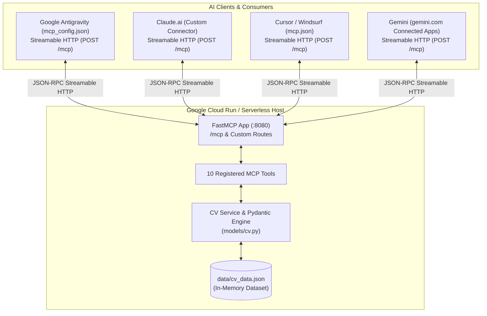
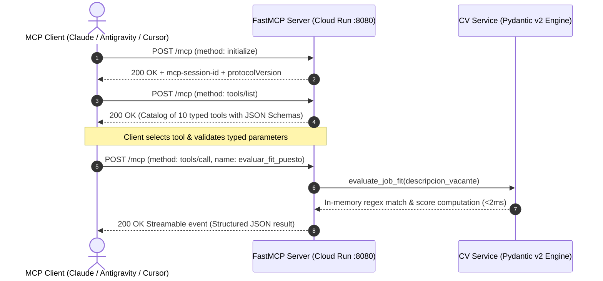

<p align="center">
  
</p>

# Ana-Catalina MCP Server

[English](README.md) | [Español](README.es.md)

<p align="center">
  <a href="https://www.python.org/"></a>
  <a href="https://docs.pydantic.dev/"></a>
  <a href="https://modelcontextprotocol.io/"></a>
  <a href="https://cloud.google.com/run"></a>
  <a href="https://www.docker.com/"></a>
  <a href="https://docs.pytest.org/"></a>
  <a href="LICENSE"></a>
</p>

> **Official Model Context Protocol (MCP) Server** with **Streamable HTTP** transport over FastMCP, exposing an interactive CV and portfolio for AI assistants (Google Antigravity, Claude.ai, Cursor, Windsurf, Gemini) and LLM clients. Includes a self-contained web showcase and a production-ready container for Google Cloud Run.

<div align="center">
  <h3>Live Server URL:</h3>
  <p><strong><a href="https://mcp.ana-catalina.com/">https://mcp.ana-catalina.com/</a></strong></p>
  <small>(Cloud Run Mirror: <code>https://anacatalina-mcp-165536131179.us-central1.run.app/</code>)</small>
</div>

---

## Project Description

This project provides an official **Model Context Protocol (MCP)** server built in Python that enables AI assistants, hiring managers, and technical evaluators to interactively query the professional experience, technical skill matrix, featured projects, and job compatibility of **Ana-Catalina Villalobos Contardo** (Data Scientist & Machine Learning Engineer).

### Two Interfaces, Built for Two Audiences

| Audience | Entry Point | Purpose & Experience |
| :--- | :--- | :--- |
| 🤖 **AI Agents & Protocol Engineers** | Streamable HTTP (`POST /mcp`) | Direct machine-to-machine integration for Google Antigravity, Claude.ai, Cursor, Windsurf, and Gemini via JSON-RPC 2.0 with strongly-typed Pydantic v2 schemas. |
| 👤 **Hiring Managers & Evaluators** | Interactive Web Showcase (`GET /` or `/demo`) | Human-friendly browser playground using the *Pastel-Tech Design System* with zero installation required, deterministic vacancy fit benchmarks, and instant sub-5ms responses. |

### Key Features
- **Interactive Web Showcase & Playground:** Served directly at `/` (serves 200 OK directly to browsers via transparent content negotiation, with `/demo` as direct alias) using the *Pastel-Tech Design System*. Allows human visitors and evaluators to test job fit and query the curriculum directly in the browser with deterministic accuracy and instant in-memory responses.
- **Transparent HTTP Content Negotiation:** Serves the interactive web interface directly to browsers (`Accept: text/html`) with HTTP 200 without redirects, while preserving the structured JSON discovery payload for programmatic agents and cURL.
- **Modern Streamable HTTP Transport (`/mcp`):** Native transport standard for direct cloud connections from **Google Antigravity** (`mcp_config.json`), **Claude.ai** (custom connectors), **Gemini** (gemini.com Connected Apps) and **Cursor / Windsurf** (`mcp.json`).
- **10 Dedicated MCP Tools:** Granular exploration of work history, skill taxonomy by category/level, highlighted projects, automated job fit scoring, full-text curriculum search, education, contact details, and general profile.
- **Zero-Latency In-Memory Architecture:** Clean data validation using **Pydantic v2** loaded into memory on container startup (<2ms response time).

---

## Architecture



### Protocol Lifecycle & Live Invocation Demonstration



#### Real Protocol Invocation Example

1. **Request (`POST https://mcp.ana-catalina.com/mcp`):**
```json
{
  "jsonrpc": "2.0",
  "id": 1,
  "method": "tools/call",
  "params": {
    "name": "evaluar_fit_puesto",
    "arguments": {
      "descripcion_vacante": "Senior Machine Learning Engineer with Python, GCP, BigQuery and Docker"
    }
  }
}
```

2. **Structured Response (`200 OK`, `text/event-stream`):**
```json
{
  "jsonrpc": "2.0",
  "id": 1,
  "result": {
    "structuredContent": {
      "target_role_detected": "Senior Data Scientist / Machine Learning Engineer",
      "estimated_fit_score": "85% (Alta Compatibilidad)",
      "technologies_matched": ["Python", "BigQuery", "Google Cloud Platform (GCP)", "Docker"],
      "matching_strengths": [
        "Production experience at SimpliRoute applying Python, BigQuery, and GCP to logistics optimization and MCP servers.",
        "Track record at Fracttal leading analytical pipelines, predictive maintenance, and Python deployments.",
        "Deep expertise across the Google Cloud data and ML ecosystem."
      ],
      "added_value_summary": "Ana-Catalina's profile provides high synergy in Python, BigQuery, Google Cloud Platform (GCP), Docker, combining real production experience in high-growth tech startups with strong civil engineering, advanced analytics, and predictive modeling."
    },
    "isError": false
  }
}
```

---

## MCP Tools Catalog

The server exposes **10 official tools** registered via the Model Context Protocol:

| Tool | Parameters | Return Type | Description |
| :--- | :--- | :--- | :--- |
| `obtener_experiencia` | `empresa` *(str, optional)* | `List[ExperienceItem]` | Detailed employment history, roles, responsibilities, and technologies used. Filterable by company. |
| `obtener_stack_tecnologico` | `categoria` *(str, optional)*<br/>`nivel` *(str, optional)* | `List[SkillCategory]` | Technologies, languages (Python, SQL), Cloud/GCP (BigQuery, Vertex AI) and Docker by category and level. |
| `obtener_proyectos_destacados` | `tipo` *(str, optional)*<br/>`tecnologia` *(str, optional)* | `List[ProjectItem]` | Highlighted portfolio projects, architecture, stack, and live demos/repo links. |
| `evaluar_fit_puesto` | `descripcion_vacante` *(str, required)* | `FitEvaluationResult` | Evaluates job requirements and calculates compatibility score, matching strengths, and value proposition. |
| `buscar_en_curriculum` | `consulta` *(str, required)* | `SearchResult` | Cross-cutting keyword search across experience, skills, projects, and education (Pydantic model with backwards-compatible dict indexing). |
| `obtener_educacion` | *None* | `List[EducationItem]` | Formal university degrees, institutions, and specializations. |
| `obtener_publicaciones` | *None* | `List[PublicationItem]` | Indexed scientific research papers (Structural Health Monitoring, Gaussian Processes, Bayesian inference). |
| `obtener_contacto` | *None* | `ContactDetails` | Direct professional contact channels (Email, LinkedIn). |
| `obtener_perfil` | *None* | `PersonalInfo` | General profile: name, title, location, and portfolio links. |
| `obtener_resumen_ejecutivo` | `idioma` *(str, default="es")* | `str` | Executive career summary focused on Data Science, ML, GCP, and MCP architecture in English or Spanish. |

---

### Tech Stack

- **Language & Runtime:** Python 3.12+
- **MCP Framework & Transport:** Official Anthropic SDK (`mcp>=1.3.0,<2.0.0`, `FastMCP` over Streamable HTTP `/mcp`)
- **Web / ASGI Server:** Starlette (`<2.0.0`) + Uvicorn (`<1.0.0`) + Pure-ASGI Security & Rate-Limiting Middleware
- **Data Validation & Contracts:** Pydantic v2 (`<3.0.0`)
- **Frontend Showcase:** Self-contained Vanilla HTML5, CSS3 (*Pastel-Tech Design System*), and Modern ES6 (`/demo` & `GET /`)
- **Containerization & Cloud:** Non-root Docker (`python:3.12-slim`, `appuser`) deployed on Google Cloud Run
- **Testing & Security Auditing:** `pytest`, `pytest-asyncio`, `pytest-cov`, `pip-audit`, and GitHub Actions (`test.yml`, `upstream-drift.yml`, Dependabot)

---

## Local Setup & Development

### 1. Clone Repository & Setup Virtual Environment

```bash
git clone https://github.com/AnaCataVC/anacatalina-mcp.git
cd anacatalina-mcp

# Create and activate virtual environment
python -m venv .venv
source .venv/bin/activate  # On Windows PowerShell: .venv\Scripts\Activate.ps1

# Install production and development dependencies
pip install -r requirements.txt
pip install -r requirements-dev.txt
```

### 2. Start Local MCP Server

```bash
uvicorn server:app --host 0.0.0.0 --port 8080 --reload
```

### Automated Testing

Execute the complete automated test suite (unit, protocol contracts, content negotiation, security headers, rate limiting, and upstream data synchronization):

```bash
# Run the complete automated test suite with zero regressions
pytest tests/ -v

# Run test suite with line coverage report
pytest tests/ -v --cov=models --cov=services --cov=server --cov-report=term-missing

# Audit dependencies for known CVEs
python -m pip_audit -r requirements.txt

# Verify data alignment against sibling repositories (anacatalina-cv and projects-hub)
python scripts/sync_mcp_data.py --check-only
```

### Quality Assurance & Risk Mitigation Matrix

| Architectural Concern / Risk | Production Implementation & Safeguard | Concrete Automated Evidence |
| :--- | :--- | :--- |
| **Protocol Compliance & Discovery** | FastMCP Streamable HTTP (`POST /mcp`) | Contract tests for `initialize`, `tools/list`, and `tools/call` ([`tests/test_server.py`](tests/test_server.py)) |
| **Schema Stability & Type Safety** | Pydantic v2 strict models (`models/cv.py`) | 100% typed serialization & boundary validation tests |
| **Structured Error Handling** | Envelope validation with Pydantic v2 error payloads | Automated error tests (`isError: true` on missing args / unknown tools) |
| **Content Negotiation (Zero Latency)** | Transparent ASGI route handler (`GET /`, zero redirects) | 7 content negotiation tests ([`tests/test_content_negotiation.py`](tests/test_content_negotiation.py)) |
| **Abusive Traffic & DOS Protection** | Pure-ASGI in-memory sliding window rate limiter | Bounded per-IP rate limit test verifying HTTP `429 Too Many Requests` |
| **Security Headers Injection** | Injects `X-Content-Type-Options`, `X-Frame-Options` on all responses | Automated security headers injection tests |
| **Container & Runtime Privileges** | Non-root `appuser` Debian slim Docker container | Cloud Run serverless non-privileged container sandbox |
| **Dependency Vulnerabilities** | Upper-bound version pinning & CVE auditing | Automated `pip-audit` execution in CI/CD pipeline ([`test.yml`](.github/workflows/test.yml)) |
| **Cross-Portfolio Data Drift** | Standalone dataset + semantic comparison engine | Daily GitHub Actions drift audit workflow ([`upstream-drift.yml`](.github/workflows/upstream-drift.yml)) |

---

## Connecting AI Assistants

- **Google Antigravity / Gemini CLI (`~/.gemini/config/mcp_config.json`):**
  ```json
  {
    "mcpServers": {
      "anacatalina-cv": {
        "url": "https://mcp.ana-catalina.com/mcp"
      }
    }
  }
  ```
- **Cursor / Windsurf (`~/.cursor/mcp.json`):**
  ```json
  {
    "mcpServers": {
      "anacatalina-cv": {
        "url": "https://mcp.ana-catalina.com/mcp"
      }
    }
  }
  ```
- **Claude.ai:** Settings → Connectors → Add custom connector → URL: `https://mcp.ana-catalina.com/mcp`
- **Gemini (`gemini.google.com`):** Settings & help → Connected Apps → Custom apps for Spark → Add a custom app → URL: `https://mcp.ana-catalina.com/mcp`
- **cURL / Direct HTTP Client:**
  ```bash
  curl -X POST https://mcp.ana-catalina.com/mcp \
    -H "Content-Type: application/json" \
    -H "Accept: application/json, text/event-stream" \
    -d '{"jsonrpc":"2.0","id":1,"method":"tools/list","params":{}}'
  ```

---

### Key Learnings & Architectural Decisions

1. **MCP Transport Evolution (Migration to Streamable HTTP):**
   - Traditional remote MCP servers relied on complex multi-endpoint SSE combinations (`/sse` and `/messages/`).
   - The modern MCP specification introduced **Streamable HTTP** (`/mcp`) via a single unified HTTP POST endpoint supporting both JSON responses and streaming events (`Accept: application/json, text/event-stream`).
   - This eliminates local `stdio` bridge overhead for remote clients and enables direct cloud connections from Claude.ai, Cursor, and Windsurf.

2. **Decoupled Architecture & Strongly-Typed Contracts (`SearchResult`):**
   - Separating raw data (`data/cv_data.json`), interface contracts (`models/cv.py`), and domain services (`services/cv_service.py`) ensures that CV content updates never compromise server stability or type safety.
   - Formalizing `SearchResult` with Pydantic v2 and backwards-compatible dictionary indexing (`__getitem__`) exposes explicit JSON Schemas to LLM assistants without breaking existing callers or test assertions.

3. **Transparent HTTP Content Negotiation (Zero Redirects):**
   - Root `GET /` serves HTML directly to web browsers (`Accept: text/html`) with HTTP 200 while delivering JSON discovery to automated agents, eliminating 301/302 redirect latency.
   - Template caching via `@functools.lru_cache(maxsize=1)` ensures zero-overhead template delivery while supporting live reloads in local development (`DEBUG=1`).

4. **Declarative Static Asset Dispatcher & Test Suite Coverage:**
   - Centralizing all static assets in a single immutable `STATIC_ASSETS` registry in `server.py` eliminated 60+ lines of duplicate routing code while strictly preserving root canonical URLs and preventing path traversal.
   - Comprehensive automated test suite running with **100% passing rate / zero regressions** across all protocol lifecycle contracts (schema discovery, argument validation, error envelopes), REST endpoints, transparent content negotiation, security headers, rate limiting, and semantic benchmark consistency.

5. **Upper-Bound Dependency Pinning & Unused Package Pruning (`requirements.txt`):**
   - Version 2.0 of the official MCP SDK introduced breaking renames to `FastMCP`. All runtime dependencies enforce explicit major upper bounds (`mcp>=1.3.0,<2.0.0`, `starlette<2.0.0`, `pydantic<3.0.0`) and unused transitive wrappers (`fastapi`) were pruned to reduce container attack surface.

6. **Automated Upstream Drift Detection (`upstream-drift.yml`):**
   - Built a GitHub Actions workflow (`upstream-drift.yml`) using semantic content comparison to detect discrepancies and missing keys between `data/cv_data.json` and sibling repositories (`anacatalina-cv`, `projects-hub`).

7. **Pure-ASGI Security Middleware, Sliding-Window Rate Limiting & DevOps Hardening:**
   - Implemented `SecurityAndRateLimitMiddleware` as a pure ASGI middleware (registered via `app.add_middleware`) rather than Starlette's `BaseHTTPMiddleware` to avoid response buffering on `/mcp` `text/event-stream` channels while preserving `app.routes` introspection.
   - Enforces bounded per-IP in-memory sliding-window rate limiting (`120 req/min`, max 4096 tracked IPs), standard HTTP security headers (`X-Content-Type-Options: nosniff`, `X-Frame-Options: DENY`) across all responses including `429`, non-root Docker execution (`appuser`), and automated `pip-audit` vulnerability scanning in CI.

---

## License

This project is licensed under the MIT License. See [LICENSE](LICENSE) for details. Developed by **Ana-Catalina Villalobos Contardo**.
